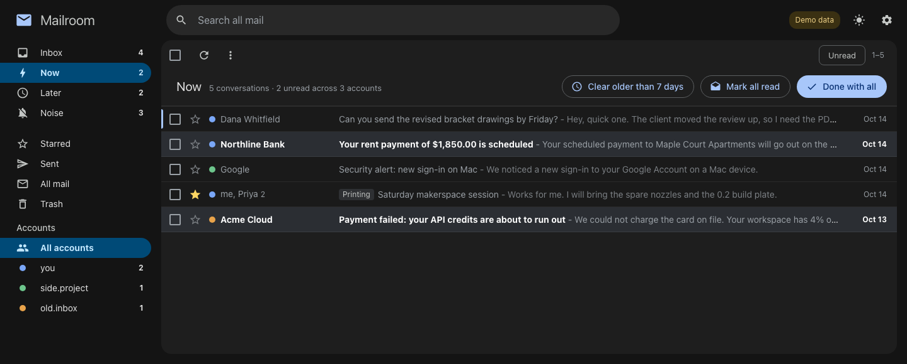
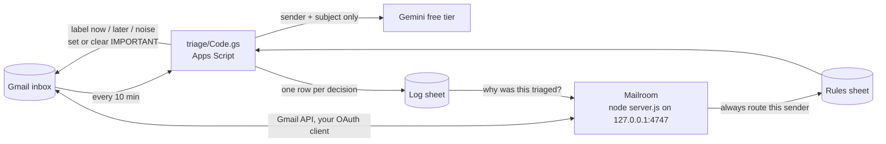
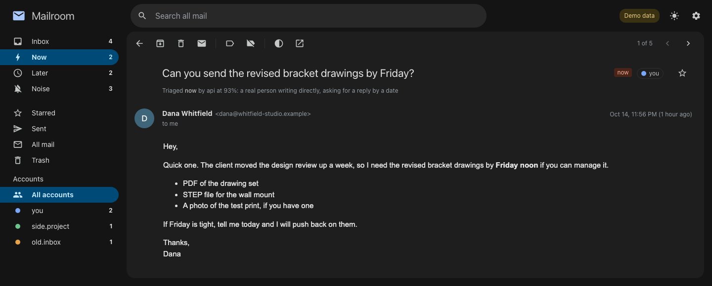

# Mailroom

A local Gmail client for several personal accounts at once, plus the Apps Script that sorts their mail into `now`, `later` and `noise` before I ever look.



I have more than one personal Gmail account and my phone buzzed for all of them. I wanted it to buzz only for mail a person actually needs me to answer, and I wanted one place to read and clear everything else.

## How it works

Two pieces. The triage script sorts, Mailroom is where you read.



**The triage script** (`triage/Code.gs`) runs on a time trigger in each Gmail account. It picks up inbox threads that don't have a triage label yet and decides one of three buckets:

| Label | What happens in Gmail |
|---|---|
| `now` | Marked Important, stays in the inbox. This is what reaches the phone. |
| `later` | Important cleared, archived. |
| `noise` | Important cleared, archived. |

Gmail's mobile app has a "High priority only" notification setting that fires on the Important flag. Gmail's own guess at Important is noisy, so the script overwrites it. With that setting on, only `now` mail makes the phone buzz.

Each thread goes through, in order: hard rules from the sheet (sender address or domain only), a per-sender cache, a cache keyed on sender plus a rough "shape" of the subject, and only then Gemini, 20 emails per call. Only the sender and subject leave the account. Bodies are never read. That's deliberate: on the Gemini free tier Google may use what you send to improve its products and people may read it, so the payload is the minimum that still classifies well. Once a sender gets the same answer 5 times in a row it stops costing API calls. One disagreement and it never collapses again, which keeps a vendor's billing alerts and its drip marketing apart.

Email content is treated as untrusted. The prompt says so, `<` and `>` are stripped so a subject can't close its own tag, and the output is validated hard: the model can only return one of three labels for an index it was given. Anything malformed falls back to `later`.

A few guards sit after the model:

- Under 0.7 confidence, `now` and `noise` become `later`. Missing an alert is worse than an extra email in Later.
- Nothing older than 30 days can be `now`.
- Mail you sent yourself can't be `now` unless its subject starts with a prefix you choose (`SELF_SENT_ALLOW_PREFIX`), and the same self-alert twice in 6 hours goes to `later` the second time.
- `DRY_RUN=true` labels only: no archiving, no Important changes.

The `rules` and `prompt` tabs in the sheet are the live config. The script creates them on its first run and reads them fresh every run, so I can fix a misroute from my phone and the next run picks it up. Every decision lands as a row in the log sheet with the reason, source (rule, sender, cache or api) and confidence.

**Mailroom** is a single Node server with zero dependencies. It binds to `127.0.0.1` only and talks to the Gmail API directly with your own OAuth client. Nothing goes through a third party. It shows every connected account in one list, with Now, Later and Noise in the sidebar, Gmail's layout and shortcuts, and one-click "clear the whole bucket".



The line under the subject comes from the log sheet: Mailroom looks up the thread id and shows why the script put it there. If it's wrong, the move menu has "Always route this sender", which writes a row to the rules sheet so the script gets it right next time.

| In Mailroom | What changes in Gmail |
|---|---|
| Done (`e`) | Removes the triage label and archives. |
| Clear label (`y`) | Removes the triage label only. |
| Move to Now (`1`) | Adds `now`, puts it in the inbox, marks it Important. Same as the script. |
| Move to Later / Noise (`2` / `3`) | Adds the label, archives, clears Important. |
| Clear older than 7 days (Now) | Archives Now conversations with no new message in 7 days. Shows the count first. |
| Done with all / Clear all | Every conversation in the bucket, not just the loaded page. |

Every action has an Undo toast (`z` works too), and bulk undos stay available for 15 minutes. Nothing here deletes mail; trash is Gmail's normal 30-day trash. A conversation labeled both `now` and `later` only shows in Now, because the script labels your own replies `later` and a live conversation would otherwise drift out of Now.

Search covers all mail and understands loose dates and partial names: `invoice from acme last month`, `pri` (finds Priya), `between jun 1 and jun 15`. Gmail operators still work.

There's also a Raycast extension in `raycast-extension/` for reading and triaging without opening the app, and `site/` is the two-page landing and privacy site I used for the Google OAuth consent screen.

## Try it with fake mail

```bash
node server.js --demo
```

Open http://127.0.0.1:4747. Three made-up accounts, about twenty made-up threads, and nothing touches Google. Changes live in memory until you stop the server. The screenshots above are from this mode.

## Setup

### 1. The triage script (once per Gmail account)

1. Create a Google Sheet for rules. Copy its id from the URL (the long string between `/d/` and `/edit`).
2. Go to [script.google.com](https://script.google.com) signed in as the account, and create a new project.
3. Paste `triage/Code.gs` into `Code.gs`. Turn on "Show appsscript.json" in Project Settings and replace it with `triage/appsscript.json`.
4. In Project Settings, add Script Properties:

   | Property | Value |
   |---|---|
   | `GEMINI_API_KEY` | A free key from [aistudio.google.com](https://aistudio.google.com/apikey) |
   | `RULES_SHEET_ID` | The rules sheet id. Share the sheet with your other accounts so they all read it. |
   | `DRY_RUN` | `true` for the first few days |
   | `MODEL` | Optional, defaults to `gemini-3.5-flash` |
   | `SELF_SENT_ALLOW_PREFIX` | Optional, e.g. `[alert]` |

5. Run `setup()`. It creates the three labels and a log sheet, and seeds the `rules` and `prompt` tabs. Approve the permissions prompt.
6. Run `listModels()` and `testClassifier()`. The second sends two fake emails and should print PASS.
7. Run `installTrigger()`. It runs `triage()` every 10 minutes.
8. After a few days, run `logSummary()` to see what's being silenced, then set `DRY_RUN` to `false`.

Change the prompt or rules a lot and already-labeled threads keep their old answers. `resetLabels()` strips the labels and caches so everything gets re-judged; `forgetSender("x@example.com")` does it for one sender.

### 2. Mailroom

You need Node 18 or newer.

1. **Create a Google Cloud project** at https://console.cloud.google.com/projectcreate. Any name.
2. **Enable two APIs**: [Gmail API](https://console.cloud.google.com/apis/library/gmail.googleapis.com) and [Google Sheets API](https://console.cloud.google.com/apis/library/sheets.googleapis.com). Sheets is for the "why" line and for writing rules.
3. **Consent screen**: open [Google Auth Platform](https://console.cloud.google.com/auth/overview), app name `Mailroom`, audience External, your email as contact. Then under Audience, click Publish app. Leaving it in Testing works, but Google expires the sign-in every 7 days.
4. **Client**: [Clients](https://console.cloud.google.com/auth/clients), Create client, type Desktop app. Keep the client ID and secret (or download the JSON).
5. Run `npm start`, open http://127.0.0.1:4747, paste the ID and secret (or the whole JSON) on the setup page, then click Connect for each account. Google will warn the app is unverified. It's your app: Advanced, Go to Mailroom, and tick both permission boxes.

The client secret and refresh tokens are stored in `~/.config/mailroom/` (`config.json` and `tokens.json`, mode `600`), outside the repo. Removing an account in Settings revokes its token.

Then point Mailroom at your sheets in `~/.config/mailroom/config.json`:

```json
{
  "accounts": ["you@example.com", "side.project@example.com"],
  "rulesSheet": "<rules sheet id>",
  "ruleSheets": { "you@example.com": "<that account's log sheet id>" },
  "labels": { "now": "Triage/Now", "later": "Triage/Later", "noise": "Triage/Noise" }
}
```

`accounts` sets the sidebar order. `rulesSheet` is where "Always route this sender" writes. `ruleSheets` maps each account to the log sheet `setup()` created (the name is historical). `labels` is only needed if your labels aren't literally `now` / `later` / `noise`.

| Env var | Default |
|---|---|
| `MAILROOM_PORT` | `4747` |
| `MAILROOM_HOME` | `~/.config/mailroom` |
| `MAILROOM_RULES_SHEET` | none; used if `rulesSheet` isn't in config |
| `MAILROOM_DEMO` | `1` is the same as `--demo` |

**Keep it running.** `launchd/mailroom.plist` is a watchdog that starts the server at login and restarts it within 10 seconds if it dies. Edit `DIR` in it, then:

```bash
cp launchd/mailroom.plist ~/Library/LaunchAgents/local.mailroom.plist
launchctl load ~/Library/LaunchAgents/local.mailroom.plist
```

launchd can't read `~/Downloads`, `~/Desktop` or `~/Documents`, so keep the repo somewhere else (I use `~/mailroom`). `Start Mailroom.command` and the scripts in `raycast/` start it on demand instead.

**Raycast**: `cd raycast-extension && npm install && npm run dev`, wait for `ready`, then Ctrl+C. The commands stay in Raycast. Set the Mailroom folder in the extension's preferences if it isn't `~/mailroom`.

## Security notes

- Listens on `127.0.0.1` only. Requests with a foreign `Host` (DNS rebinding) or a cross-site origin are rejected, and every API call needs an `X-Mailroom` header a web page can't send cross-origin.
- Email HTML renders in a sandboxed iframe with scripts, forms and top navigation blocked; `<script>`, `<base>`, meta refresh and embedded frames are stripped first.
- Remote images load straight from the sender, which lets trackers see your IP. Settings has a switch to block them per message.
- OAuth uses PKCE with a loopback redirect. The Gmail scope is `gmail.modify` (read, label, trash). It can't permanently delete mail.

## What's rough

- No compose or reply. `r` opens the thread in Gmail, signed in as the right account.
- The triage script's Gmail quota is per account per day. A big first backfill on a busy inbox can run out partway and finish the next day.
- Rules match on sender only. A vendor that sends both alerts and marketing has to go through the model.
- The rules sheet, log sheets and accounts are wired up by hand in `config.json`. There's no setup screen for them.
- Built for macOS. The server runs anywhere Node does, but the launchd watchdog, `.command` file and Raycast extension are Mac-only.

```
server.js         HTTP server, OAuth, Gmail + Sheets calls
render.js         email HTML to clean text for Raycast
search.js         loose dates and partial names to Gmail queries
demo.js           fake accounts and mail for --demo
public/           the web app (no build step)
raycast-extension/, raycast/   Raycast extension and script commands
triage/           the Apps Script and its manifest
launchd/          the watchdog plist
site/             landing and privacy pages
```
